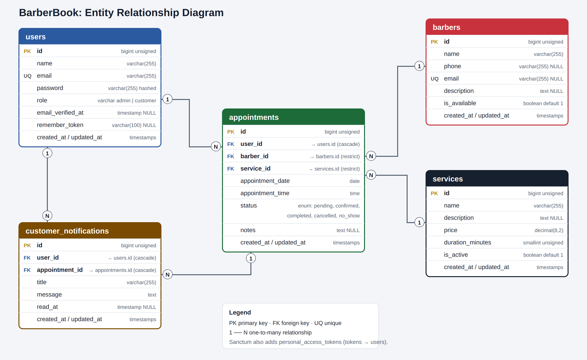
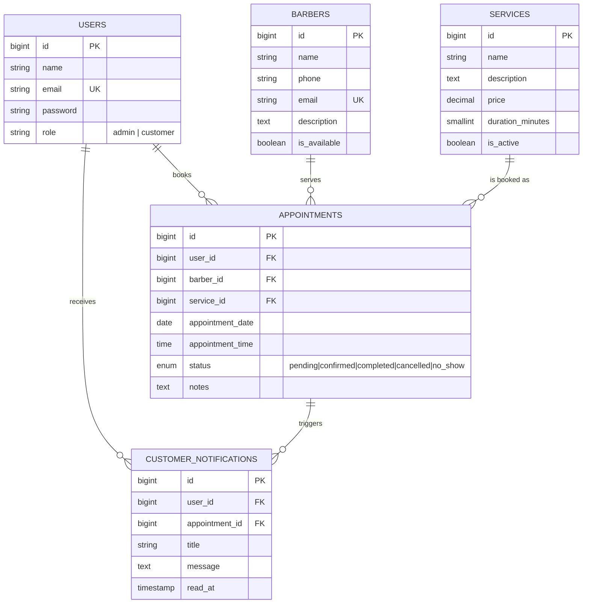

# Entity Relationship Diagram

Editable vector version: [`ERD.svg`](ERD.svg).

## Relationships

| Relationship | Type | Meaning |
|---|---|---|
| `users` → `appointments` | one-to-many | A customer has many appointments (`appointments.user_id`) |
| `barbers` → `appointments` | one-to-many | A barber has many appointments (`appointments.barber_id`) |
| `services` → `appointments` | one-to-many | A service is booked in many appointments (`appointments.service_id`) |
| `users` → `customer_notifications` | one-to-many | A customer receives many notifications |
| `appointments` → `customer_notifications` | one-to-many | An appointment can generate several notifications |

Foreign-key rules: deleting a **user** cascades to their appointments and notifications; a **barber** or **service** that
has appointments **cannot be deleted** (`restrict`), which protects booking history.

## Mermaid version (renders automatically on GitHub)

