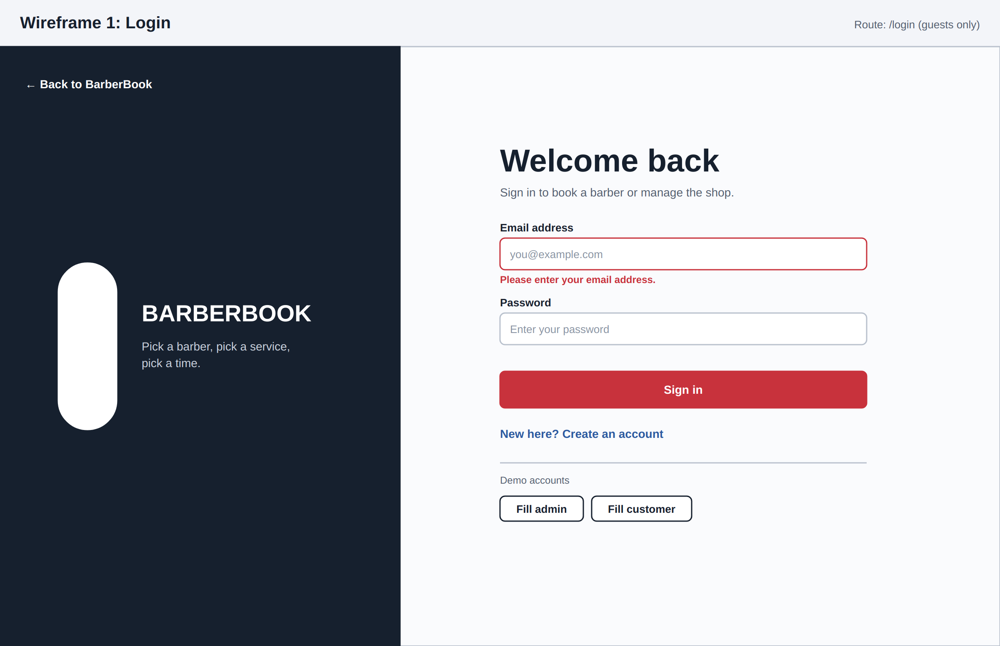
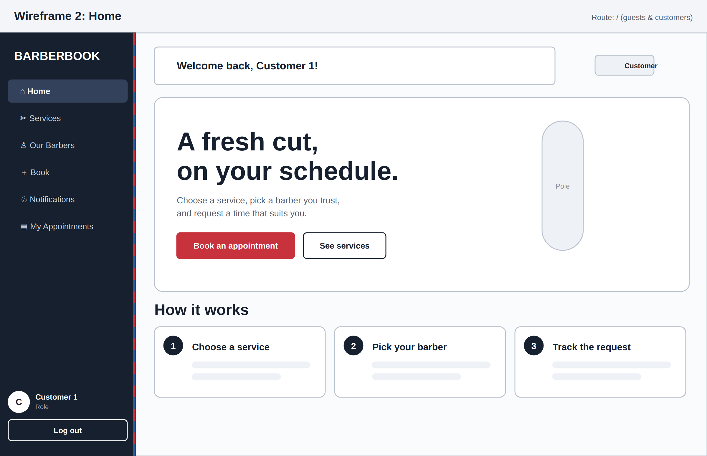
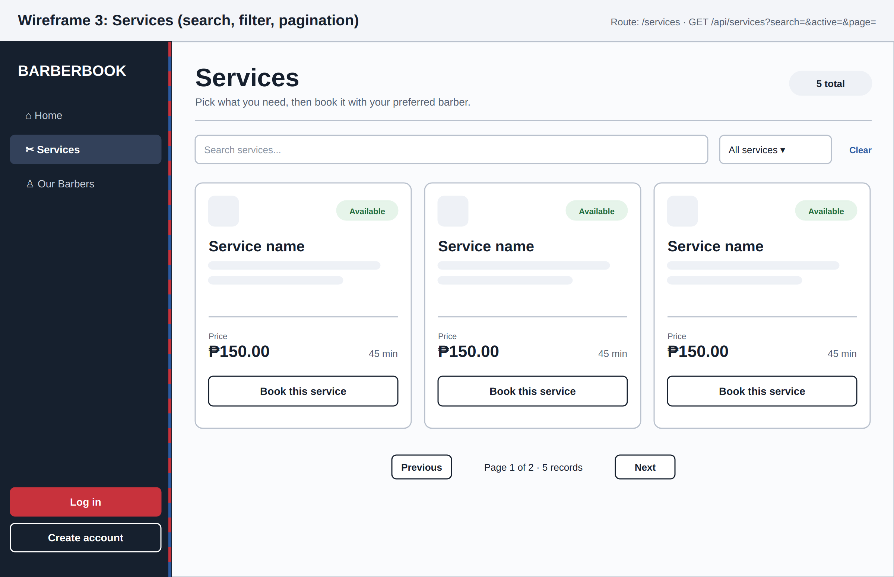
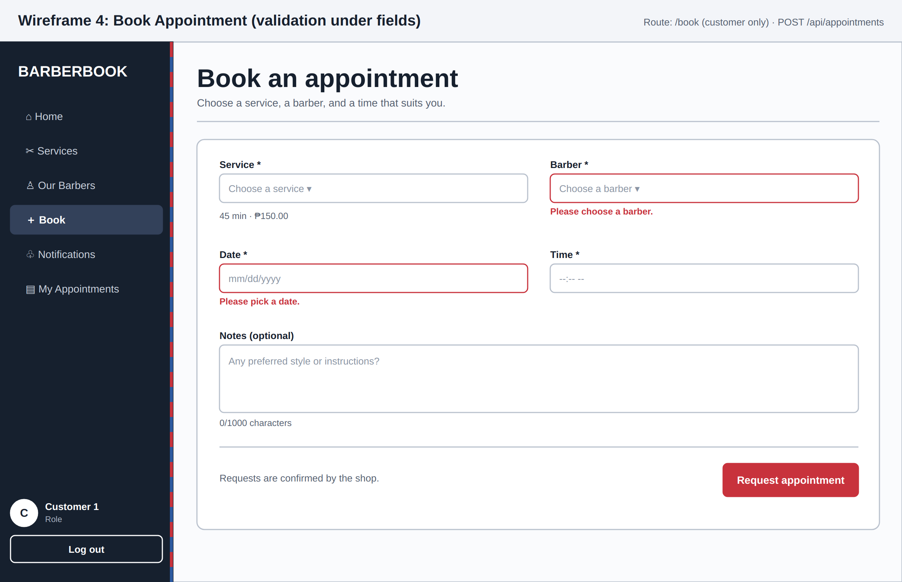
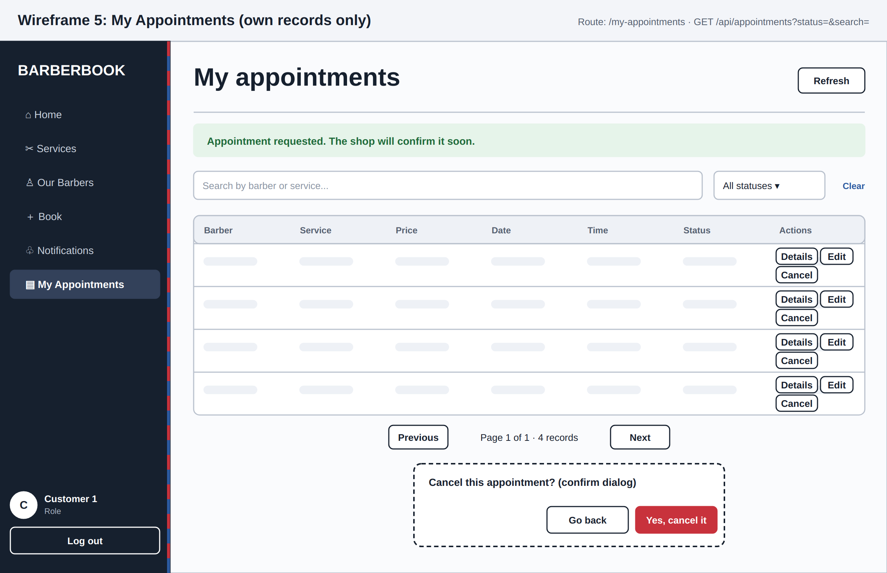
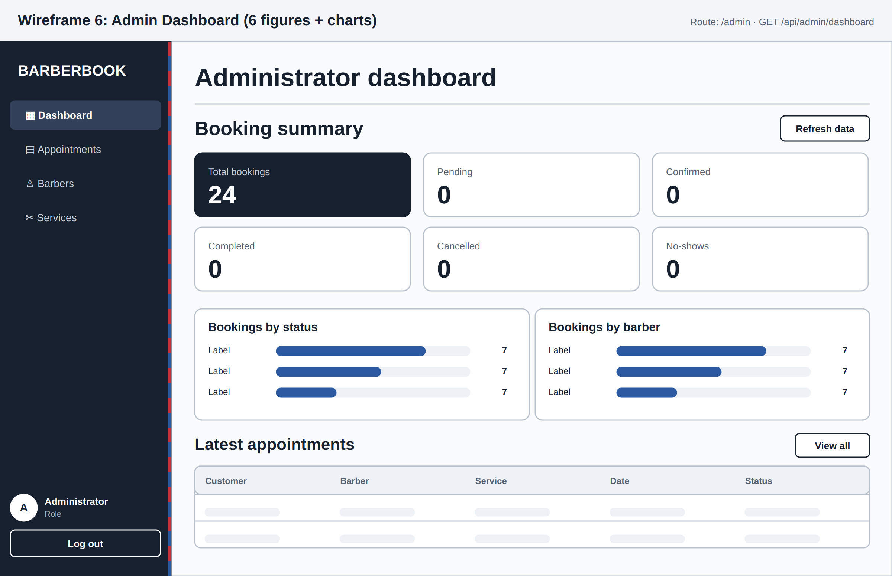
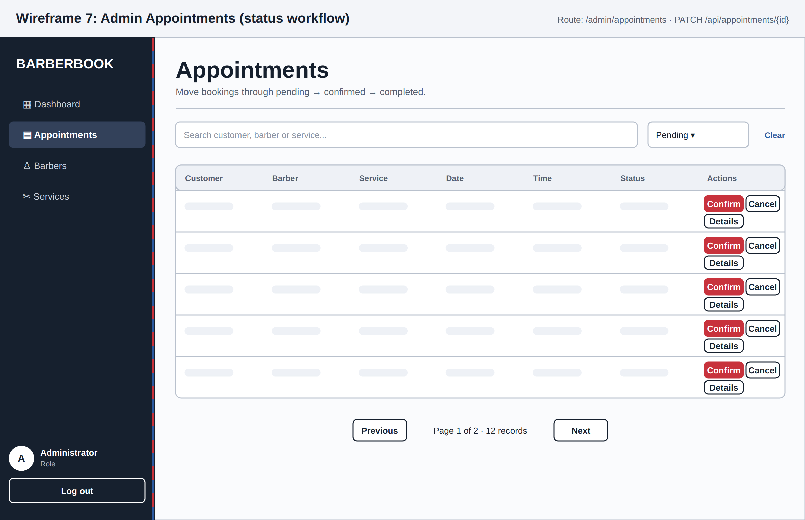
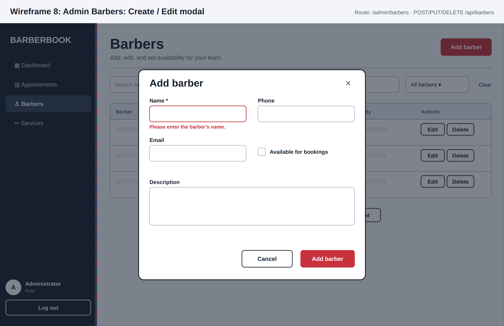
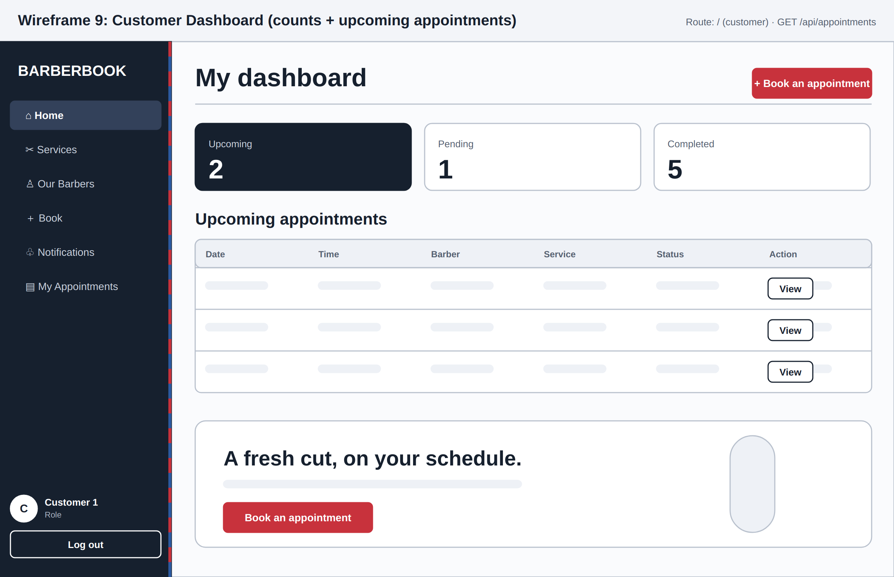

# Wireframes

Low-fidelity layouts of the key pages (PNG + editable SVG in `docs/wireframes/`). Every page shows its route and API call.

| # | Page | Route | File |
|---|---|---|---|
| 1 | Login (with validation message) | `/login` | `wireframes/01-login.png` |
| 2 | Home | `/` | `wireframes/02-home.png` |
| 3 | Services (search, filter, pagination) | `/services` | `wireframes/03-services.png` |
| 4 | Book appointment (errors under fields) | `/book` | `wireframes/04-book.png` |
| 5 | My appointments (own records, confirm dialog) | `/my-appointments` | `wireframes/05-my-appointments.png` |
| 6 | Admin dashboard (6 figures + charts) | `/admin` | `wireframes/06-admin-dashboard.png` |
| 7 | Admin appointments (status workflow) | `/admin/appointments` | `wireframes/07-admin-appointments.png` |
| 8 | Admin barbers (create/edit modal) | `/admin/barbers` | `wireframes/08-admin-barbers-modal.png` |
| 9 | Customer dashboard (proposal §5.2) | `/` (customer) | `wireframes/09-customer-dashboard.png` |

## Route map

| Area | Routes | Guard |
|---|---|---|
| Public (guest + customer) | `/` `/services` `/barbers` | none (admins are redirected to `/admin`) |
| Guest only | `/login` `/register` | signed-in users are redirected home |
| Customer only | `/book` `/my-appointments` `/notifications` | `ProtectedRoute role="customer"` |
| Admin only | `/admin` `/admin/appointments` `/admin/barbers` `/admin/services` | `ProtectedRoute role="admin"` |
